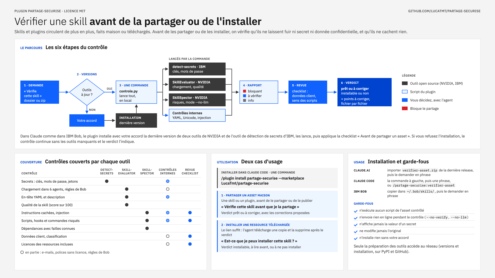

# partage-securise

 

Avant de partager une skill ou un plugin, ou avant d'installer une ressource téléchargée, on vérifie qu'il ne contient ni secret oublié, ni donnée personnelle, ni instruction cachée, ni script suspect. Ce dépôt fournit la skill **`verifier-asset`**, qui fait ce contrôle et rend un verdict avec les points à corriger.

Elle fonctionne dans Claude (claude.ai, Cowork, Claude Code) et dans d'autres agents qui lisent le format des skills.

## In English

`verifier-asset` is an agent skill that checks a skill or a plugin before you share it, or a downloaded one before you install it: leaked secrets, personal or confidential data, hidden instructions, risky scripts. It runs three open-source scanners from specialist vendors (NVIDIA SkillEvaluator and SkillSpector, IBM detect-secrets), keeps them up to date with your consent, merges their findings into a single report, then reviews what no tool can see. Install it in Claude Code with `/plugin install partage-securise --marketplace LucaTmt/partage-securise`, then ask: “check this skill before I share it”. The documentation and the skill's instructions are in French.

## Le principe : s'appuyer sur des spécialistes, et agréger

La skill n'essaie pas de tout détecter elle-même. Elle s'appuie sur trois outils open source, développés et maintenus par des entreprises spécialisées, chacun fort sur un terrain précis :

| Outil | Éditeur | Son terrain |
|---|---|---|
| [SkillEvaluator](https://github.com/NVIDIA/SkillEvaluator) | NVIDIA | la skill se charge-t-elle dans les principaux agents, et quelle est sa qualité |
| [SkillSpector](https://github.com/NVIDIA/SkillSpector) | NVIDIA | instructions cachées, envoi de données, scripts suspects, dépendances vulnérables |
| [detect-secrets](https://github.com/IBM/detect-secrets) | IBM | clés d'API, mots de passe et jetons oubliés |

Ce que la skill ajoute :

- **Des outils à jour.** Avant chaque contrôle, elle compare la version installée de chaque outil à sa dernière version publiée (PyPI, releases GitHub), et propose la mise à jour, qui n'a lieu qu'avec votre accord. Leurs éditeurs améliorent la détection : en profiter ne demande aucun travail de votre côté.
- **Un seul rapport.** Une commande lance les trois outils et des contrôles maison, puis agrège leurs résultats en un rapport unique, trié en *bloquant*, *à vérifier* et *info*, avec la version de chaque outil, car une nouvelle version peut changer le résultat sur un même asset.
- **La revue de ce qu'aucun outil ne voit.** L'agent applique ensuite une checklist : données confidentielles, sens réel des scripts, licences.

Pourquoi agréger : aucun outil ne couvre tout. SkillSpector, par exemple, ne cherche pas les secrets : une skill contenant une clé AWS peut en sortir classée SAFE, et seul detect-secrets la trouve.

## Installer

- **Claude Code** : une commande, `/plugin install partage-securise --marketplace LucaTmt/partage-securise` ; les variantes sont dans [Installer](plugins/partage-securise/README.md#claude-code-en-une-commande-recommandé).
- **IBM Bob** : un prompt aussi, dans [Installer › IBM Bob](plugins/partage-securise/README.md#ibm-bob).
- **claude.ai et Cowork** : importer [`verifier-asset.zip`](https://github.com/LucaTmt/partage-securise/releases/latest/download/verifier-asset.zip), joint à chaque release, dans Paramètres, Capacités.
- **Autres agents** : voir la section [Installer](plugins/partage-securise/README.md#installer) du plugin.
- **Dépendances** : Python 3.9 ou plus récent, et pour les outils d'analyse uv et git. La liste et une commande pour tout installer sont dans [Dépendances](plugins/partage-securise/README.md#dépendances).

Une fois installée, il suffit de demander : « vérifie cette skill avant que je la partage ».

## Contenu du dépôt

| Chemin | Rôle |
|---|---|
| [`plugins/partage-securise/`](plugins/partage-securise/) | le plugin, avec son [README](plugins/partage-securise/README.md) : fonctionnement, installation, outils |
| [`plugins/partage-securise/skills/verifier-asset/`](plugins/partage-securise/skills/verifier-asset/) | la skill : démarche, scripts de contrôle et [checklist](plugins/partage-securise/skills/verifier-asset/references/checklist.md) |
| [`docs/`](docs/) | le one-pager affiché en tête de cette page |
| [`.claude-plugin/`](.claude-plugin/) | la marketplace, qui permet d'installer le plugin en une commande dans Claude Code |
| [`tests/`](tests/) | les tests du contrôle, sur des skills piégées exprès ; ils tournent à chaque push |
| [`distribution/`](distribution/) | une note d'installation au format texte, jointe aux paquets distribués |
| [`CHANGELOG.md`](CHANGELOG.md) | ce qui change d'une version à l'autre |
| [`SECURITY.md`](SECURITY.md) | comment signaler une faille, en privé |
| [`CONTRIBUTING.md`](CONTRIBUTING.md) | signaler un faux positif ou un cas non détecté, lancer les tests, ajouter une détection |

## Licence

[MIT](LICENSE) : chacun peut utiliser, modifier et redistribuer ce dépôt, à condition de conserver la mention de copyright et le texte de la licence.
